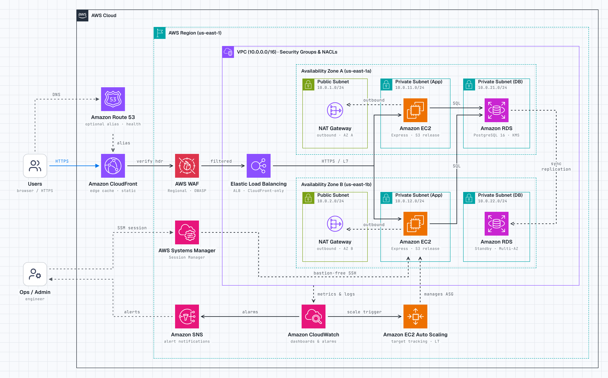

# CloudPulse — تطبيق ويب قابل للتوسع على AWS (EC2 + ALB + ASG + RDS Multi-AZ)

**مشروع التخرج الأول — شهادة AWS Solutions Architect – Associate (SAA)**

> [English Documentation (README.md)](README.md)

## نظرة عامة

**CloudPulse** هو مشروع معماري متكامل لتشغيل تطبيق ويب على **AWS** بدرجة عالية من الاعتمادية (High Availability) وقابلية التوسع (Scalability) عبر منطقتي توافر (**Availability Zones: `us-east-1a` و `us-east-1b`**):

- جميع خوادم التطبيق (**Amazon EC2** داخل **Auto Scaling Group**) وقاعدة البيانات (**Amazon RDS PostgreSQL Multi-AZ**) معزولة تماماً داخل **Private Subnets**.
- المسار الموحّد للترافيك: **Route 53 (Alias)** ← **CloudFront** (كاش `/static/*` مع حقن هيدر سري `X-CloudFront-Verify`) ← **AWS WAF** (قواعد OWASP Top 10 و Rate Limiting) ← **Application Load Balancer (ALB)** مقفول على IP ranges الخاصة بـ CloudFront فقط ← **EC2** ← **RDS Multi-AZ**.
- ملف الـ `user_data.sh` بينشر التطبيق الفعلي الموجود في `app/server.js` (Express + PostgreSQL + IMDSv2) تحت مستخدم غير مُميز (`cloudpulse`) بـ `systemd` ويتحقق من الاتصال بـ RDS عبر `/health`.
- الدخول الإداري للخوادم يتم بدون Bastion Host وبدون فتح بورت SSH عبر **AWS Systems Manager (Session Manager)**.
- المراقبة والتنبيهات تتم عبر **Amazon CloudWatch** (Dashboard + Alarms) مع **Amazon SNS**.

## مخطط المعمارية (Architecture Diagram)

<picture>
  <source media="(prefers-color-scheme: dark)" srcset="docs/architecture-dark.png">
  
</picture>

- **ملف قابل للتعديل بالماوس (draw.io):** [`docs/architecture.drawio`](docs/architecture.drawio)
- **نسخة HTML تفاعلية (تعمل Offline):** [`docs/architecture.html`](docs/architecture.html)

## تقسيم الشبكة (VPC & CIDR Plan)

| الطبقة | `us-east-1a` | `us-east-1b` | الوظيفة |
|---|---|---|---|
| **VPC** | `10.0.0.0/16` | `10.0.0.0/16` | الشبكة الافتراضية الأساسية |
| **Public Subnets** | `10.0.1.0/24` | `10.0.2.0/24` | تحتوي على ALB و NAT Gateways |
| **Private App Subnets** | `10.0.11.0/24` | `10.0.12.0/24` | تحتوي على خوادم EC2 (خروج الإنترنت عبر NAT GW) |
| **Private DB Subnets** | `10.0.21.0/24` | `10.0.22.0/24` | معزولة تماماً لـ RDS Primary و Standby |

## التشغيل السريع (وضع المحاكاة بدون حساب AWS)

تقدر تجرب دورة النشر والتحقق والتوسع التلقائي والحذف بالكامل ببيانات AWS محاكاة واقعية:

```bash
./scripts/deploy.sh --simulate --region us-east-1
./scripts/verify.sh --simulate
./scripts/simulate-load.sh --simulate
./scripts/destroy.sh --simulate
```

وللنشر الفعلي على حساب AWS باستخدام Terraform:

```bash
./scripts/deploy.sh --region us-east-1 --email ops-alerts@example.com
./scripts/verify.sh
./scripts/destroy.sh --region us-east-1
```
