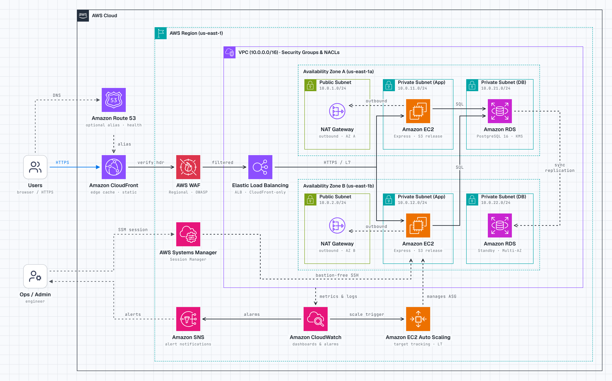

# CloudPulse — Scalable Web Application with ALB and Auto Scaling

**AWS Solutions Architect – Associate (SAA) · Graduation Project 1 (EC2-Based)**

> [النسخة العربية (README.ar.md)](README.ar.md)

CloudPulse is a production-style, multi-tier web application architected on **Amazon Web Services (AWS)** across two Availability Zones. All application compute (`Amazon EC2` inside an `Auto Scaling Group`) and relational storage (`Amazon RDS PostgreSQL Multi-AZ`) run inside isolated **private subnets**, behind **Amazon Route 53**, **Amazon CloudFront**, **AWS WAF**, and a Multi-AZ **Application Load Balancer (ALB)**. Administrative access is completely bastion-free via **AWS Systems Manager Session Manager**, with full observability through **Amazon CloudWatch** and **Amazon SNS**.

## Solution Architecture Diagram

<picture>
  <source media="(prefers-color-scheme: dark)" srcset="docs/architecture-dark.png">
  
</picture>

- **Editable Source (diagrams.net / draw.io):** [`docs/architecture.drawio`](docs/architecture.drawio)
- **Interactive Offline Preview (Light/Dark HTML):** [`docs/architecture.html`](docs/architecture.html)
- **High-Resolution PNGs:** [`docs/architecture.png`](docs/architecture.png) (Light) · [`docs/architecture-dark.png`](docs/architecture-dark.png) (Dark)

---

## Key AWS Services & Architectural Role

| Layer | AWS Service | Configuration & Responsibility |
|---|---|---|
| **DNS & Routing** | **Amazon Route 53** | Alias record pointing to the **CloudFront** distribution (unified edge entry point) with active HTTPS `/health` checks |
| **Edge Caching** | **Amazon CloudFront** | Caches static assets (`/static/*`) at global edge locations, proxies dynamic traffic to ALB, and injects a secret `X-CloudFront-Verify` header |
| **L7 Security** | **AWS WAFv2** | Attached to ALB with OWASP Top 10 managed rule groups (`Common`, `SQLi`, `KnownBadInputs`) + per-IP rate limiting (2,000 req / 5 min) |
| **Load Balancing** | **Elastic Load Balancing (ALB)** | Multi-AZ Layer 7 routing across both Public Subnets, locked to CloudFront's Managed Prefix List + `X-CloudFront-Verify` listener rule, with `/health` Target Group checks |
| **Networking** | **Amazon VPC** | `10.0.0.0/16` spanning 2 AZs (`us-east-1a`, `us-east-1b`), 6 subnets (Public, Private App, Private DB), redundant NAT Gateways, tier Security Groups, and DB Network ACLs |
| **Compute & Elasticity** | **Amazon EC2 + Auto Scaling** | Launch Template (AL2023, IMDSv2 required, encrypted gp3 EBS) deploying the real `app/server.js` Express + PostgreSQL app via `systemd`, Target Tracking (`60%` CPU) + Step Scaling (`min=2`, `desired=2`, `max=6`) |
| **Database HA** | **Amazon RDS (Multi-AZ)** | PostgreSQL 16 Primary in `us-east-1a` with synchronous Standby in `us-east-1b` for automated failover, KMS encryption at rest, and Secrets Manager password management |
| **Bastion-Free Access** | **AWS Systems Manager** | Session Manager via `AmazonSSMManagedInstanceCore` IAM role — zero inbound SSH (`port 22` closed) and no bastion host |
| **Observability** | **Amazon CloudWatch + SNS** | Unified dashboard + alarms (`EC2 CPU > 75%`, `ALB 5xx > 5`, `RDS CPU > 80%`) triggering scaling and Ops email alerts |

---

## VPC & Subnet CIDR Design

| Tier | Availability Zone A (`us-east-1a`) | Availability Zone B (`us-east-1b`) | Route Table / Internet Access |
|---|---|---|---|
| **VPC** | `10.0.0.0/16` | `10.0.0.0/16` | DNS hostnames & resolution enabled |
| **Public Subnets** | `10.0.1.0/24` | `10.0.2.0/24` | `0.0.0.0/0 -> Internet Gateway` (ALB + NAT Gateways) |
| **Private App Subnets** | `10.0.11.0/24` | `10.0.12.0/24` | `0.0.0.0/0 -> Same-AZ NAT Gateway` (EC2 ASG instances) |
| **Private DB Subnets** | `10.0.21.0/24` | `10.0.22.0/24` | Local VPC route only — **zero internet egress** (RDS Multi-AZ) |

---

## Repository Structure

```text
.
├── README.md                      # Architecture & deployment documentation (English)
├── README.ar.md                   # Arabic overview & deployment guide
├── docs/
│   ├── architecture.png           # Official AWS icon diagram (Light theme, 2x)
│   ├── architecture-dark.png      # Official AWS icon diagram (Dark theme, 2x)
│   ├── architecture.html          # Self-contained interactive HTML diagram
│   └── architecture.drawio        # Editable draw.io XML with embedded AWS icons
├── app/
│   ├── package.json               # Node.js Express + PostgreSQL web application
│   ├── server.js                  # /health, /api/status (IMDSv2 + RDS), static assets
│   └── public/                    # Frontend HTML & CSS cached by CloudFront
├── infra/
│   └── terraform/                 # Complete modular Terraform Infrastructure as Code
│       ├── main.tf                # Providers, default tags, AL2023 AMI & AZ lookups
│       ├── variables.tf           # Configurable CIDRs, ASG limits, RDS & DNS inputs
│       ├── vpc.tf                 # VPC, 6 Subnets, IGW, 2x NAT GW, Route Tables, NACLs
│       ├── security.tf            # Chained Security Groups + EC2 IAM Role (SSM/CW/Secrets)
│       ├── alb_waf.tf             # Multi-AZ ALB, Target Group, Listeners, WAFv2 OWASP rules
│       ├── compute_asg.tf         # Launch Template (IMDSv2), ASG, Target Tracking & Step Scaling
│       ├── rds.tf                 # Multi-AZ RDS PostgreSQL 16 + Secrets Manager credentials
│       ├── edge_dns.tf            # CloudFront distribution + optional Route 53 Alias/Health Check
│       ├── observability.tf       # CloudWatch Dashboard, Alarms & SNS Topic
│       ├── user_data.sh           # EC2 bootstrap script (fetches DB secret at boot)
│       └── outputs.tf             # Key endpoints & ARNs
└── scripts/
    ├── deploy.sh                  # Real Terraform deploy + realistic --simulate mode
    ├── verify.sh                  # Post-deployment validation checklist (Live + --simulate)
    ├── simulate-load.sh           # ASG scaling & RDS Multi-AZ failover exercise
    └── destroy.sh                 # Full resource teardown (Live + --simulate)
```

---

## Quick Start

### Option A — Deployment Simulation Mode (No AWS Account / Zero Cost)

Run the entire deployment, verification, Auto Scaling / RDS failover exercise, and teardown locally with realistic mock AWS resource IDs and outputs:

```bash
# 1. Simulate full Multi-AZ AWS provisioning (writes .deployment-outputs.json)
./scripts/deploy.sh --simulate --region us-east-1

# 2. Run the 6-point architecture verification checklist
./scripts/verify.sh --simulate

# 3. Simulate a traffic surge (ASG 2 -> 4 instances) and RDS Multi-AZ failover
./scripts/simulate-load.sh --simulate

# 4. Simulate clean teardown
./scripts/destroy.sh --simulate
```

### Option B — Live AWS Deployment (Terraform)

**Prerequisites:** AWS CLI v2 configured with credentials, Terraform `>= 1.6`, and `jq`.

```bash
# Copy example variables if customizing
cp infra/terraform/terraform.tfvars.example infra/terraform/terraform.tfvars

# Deploy live infrastructure to us-east-1
./scripts/deploy.sh --region us-east-1 --email ops-alerts@example.com

# Optional: include custom Route 53 domain & ACM TLS certificates for end-to-end HTTPS
./scripts/deploy.sh \
  --region us-east-1 \
  --domain app.example.com \
  --zone-id Z0123456789EXAMPLE \
  --alb-cert-arn arn:aws:acm:us-east-1:123456789012:certificate/xxxxxxxx-xxxx-xxxx-xxxx-xxxxxxxxxxxx \
  --cf-cert-arn arn:aws:acm:us-east-1:123456789012:certificate/yyyyyyyy-yyyy-yyyy-yyyy-yyyyyyyyyyyy

# Verify live endpoints, CloudFront cache headers, WAF SQLi block, ASG & SSM
./scripts/verify.sh

# Clean up all AWS resources when finished to stop billing
./scripts/destroy.sh --region us-east-1
```

---

## Security & Well-Architected Highlights

### Security Groups & Network ACL Rules

| Resource | Inbound Rules | Outbound Rules |
|---|---|---|
| **`alb-sg` (Public)** | `TCP 443` (with ALB certificate) or `TCP 80` (lab mode) strictly from AWS Managed Prefix List `com.amazonaws.global.cloudfront.origin-facing` (protected by AWS WAFv2 + `X-CloudFront-Verify` header) | `TCP 8080` to Private App Subnets (`10.0.11.0/24`, `10.0.12.0/24`) |
| **`app-sg` (Private App)** | `TCP 8080` from `alb-sg` only (**port 22 SSH closed**) | `UDP/TCP 53` to VPC DNS (`10.0.0.0/16`) · `TCP 443` via NAT Gateway (SSM, CloudWatch, Secrets Manager, updates) · `TCP 5432` to Private DB Subnets |
| **`db-sg` (Private DB)** | `TCP 5432` from `app-sg` only | Local VPC return traffic only |
| **`private-db-nacl`** | Allow `TCP 5432` from Private App CIDRs only; Deny all else | Allow ephemeral ports `1024–65535` to Private App CIDRs only |

### Encryption in Transit (End-to-End TLS Strategy)

| Hop | Protocol | Notes |
|---|---|---|
| **Users → CloudFront** | **HTTPS (`TLSv1.2+`)** | Always enforced via `viewer_protocol_policy = "redirect-to-https"`. Uses default CloudFront certificate or custom ACM cert (`cloudfront_acm_certificate_arn` in `us-east-1`). |
| **CloudFront → ALB** | **HTTPS (`TLSv1.2+`)** *(prod)* / HTTP *(lab)* | Automatically switches to `https-only` with `ELBSecurityPolicy-TLS13-1-2-2021-06` when `alb_acm_certificate_arn` is supplied (recommended for production); falls back to HTTP origin only when deploying in a lab without a custom domain/certificate. |
| **EC2 → RDS PostgreSQL** | **TLS (`SSL`)** | Encrypted connection over isolated Private Subnets (`DB_SSL=true`). |

### Application Bootstrap (`user_data.sh`)

- Terraform embeds the actual application sources (`app/package.json`, `app/server.js`, `app/public/*`) into the EC2 Launch Template and deploys them under an unprivileged `cloudpulse` system user.
- Dependencies (`express`, `pg`) are installed via `npm install --omit=dev`, RDS credentials are fetched from Secrets Manager into `/etc/cloudpulse.env` (`chmod 640`), and `systemd` starts `server.js`.
- Bootstrap verifies `http://127.0.0.1:8080/health` returns `"database":"connected"` before completing, ensuring EC2-to-RDS integration is live before the ALB marks the target healthy.

### AWS Well-Architected Alignment

- **Security (Defense in Depth):** AWS WAF (OWASP Top 10 + 2,000 req/5m rate limit) → chained Security Groups → Private DB NACL → IMDSv2 enforced (`http_tokens = "required"`) → RDS credentials auto-managed in **AWS Secrets Manager** → EBS (`gp3`) & RDS KMS encryption at rest.
- **Operational Excellence:** Zero-SSH bastion-free administration via **AWS Systems Manager Session Manager** (`AmazonSSMManagedInstanceCore`), unified CloudWatch Dashboard, and proactive SNS alerting.
- **Reliability & High Availability:** Multi-AZ VPC across `us-east-1a` & `us-east-1b`, redundant per-AZ NAT Gateways (no cross-AZ single point of failure), ELB-backed ASG health replacement, and **Multi-AZ RDS** synchronous replication with automated failover (`RPO = 0`).
- **Performance Efficiency:** **Amazon CloudFront** edge caching (`/static/*`, TTL 24h) reduces origin load and latency; Target Tracking (`60%` CPU) + Step Scaling handle traffic bursts smoothly.
- **Cost Optimization:** Right-sized `t3.micro` / `db.t3.micro` baseline, CloudFront `PriceClass_100`, automatic ASG scale-in during off-peak hours, and one-command teardown via `destroy.sh`.

---

## Cost Awareness & Cleanup

Estimated monthly cost if left running continuously in `us-east-1` (on-demand rates; verify with the [AWS Pricing Calculator](https://calculator.aws/)):

| Component | Configuration | Est. Monthly Cost (USD) |
|---|---|---|
| **NAT Gateways (2x)** | 1 per AZ + minimal data transfer | ~$65 |
| **Application Load Balancer** | 1 ALB + low LCU usage | ~$22 |
| **RDS PostgreSQL Multi-AZ** | `db.t3.micro`, 20 GB gp3 (Multi-AZ) | ~$28 |
| **EC2 Instances (2x baseline)** | `t3.micro` (ASG min=2) | ~$15 |
| **AWS WAFv2** | 1 Web ACL + 4 rules | ~$9 |
| **CloudFront, Route 53, CloudWatch, SNS** | Low demo traffic | ~$3–5 |

> **Always delete the stack after finishing your lab or demo** using `./scripts/destroy.sh --region us-east-1` to stop hourly charges.

## License & Attribution

- Project code and IaC templates are licensed under the [MIT License](LICENSE).
- Architecture diagrams use the official **AWS Architecture Icons** package for documentation purposes. All AWS service names and icons are trademarks of Amazon Web Services, Inc.
